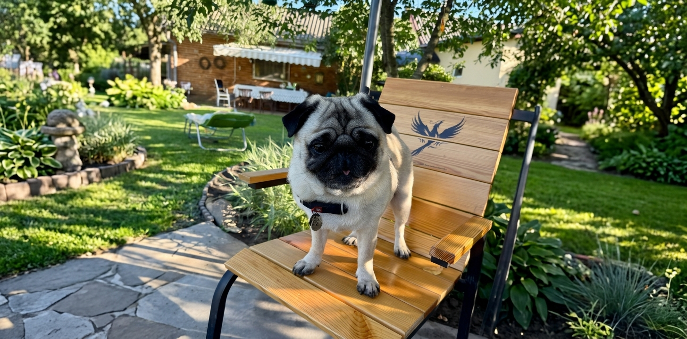

## Hey, I'm Denys

<picture>
  <source media="(prefers-color-scheme: dark)" srcset="https://raw.githubusercontent.com/DenysHerasymchuk/DenysHerasymchuk/output/github-snake-dark.svg" />
  <source media="(prefers-color-scheme: light)" srcset="https://raw.githubusercontent.com/DenysHerasymchuk/DenysHerasymchuk/output/github-snake.svg" />
  
</picture>

<h3 align="left">Connect with me:</h3>

  

# 📈 GitHub Analytics:

